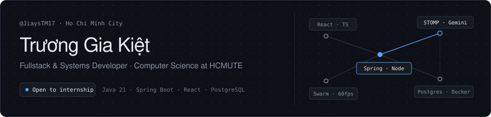

 

  <a href="https://kiet-portfolio.vercel.app" target="_blank">Portfolio</a>
  &nbsp;·&nbsp;
  <a href="mailto:truonggiakiet110806@gmail.com">Email</a>
  &nbsp;·&nbsp;
  <a href="#engineering-focus">Overview</a>
  &nbsp;·&nbsp;
  <a href="#selected-projects">Projects</a>
  &nbsp;·&nbsp;
  <a href="#github-activity">Activity</a>

---

## Engineering focus

Computer Science student at **HCMUTE** (Ho Chi Minh City, `GMT+7`) building fullstack web applications with layered backend architecture, relational data modeling, and automated verification.

<table>
  <tr>
    <td width="50%" valign="top">
      <strong>Core practices</strong>
      <ul>
        <li><b>Backend architecture:</b> Layered <code>Controller → Service → Repository</code> design, REST APIs, JWT/RBAC, and OWASP security hardening</li>
        <li><b>Real-time &amp; AI:</b> Bi-directional WebSocket (STOMP) event flows and Google Gemini API integrations</li>
        <li><b>Data &amp; quality:</b> Relational schema design (up to 34 PostgreSQL tables) and automated test suites</li>
      </ul>
    </td>
    <td width="50%" valign="top">
      <strong>Stack</strong>
      <ul>
        <li><b>Backend:</b> Java 21, Spring Boot, Spring Data JPA, Node.js, Express</li>
        <li><b>Frontend &amp; mobile:</b> React, TypeScript, JavaScript, Tailwind CSS, HTML5, CSS3, Dart / Flutter</li>
        <li><b>Data &amp; infra:</b> PostgreSQL, MongoDB, Docker, Git, Vercel</li>
      </ul>
    </td>
  </tr>
</table>

  

---

## Selected projects

<table>
  <tr>
    <td width="50%" valign="top">
      <h3><a href="https://github.com/JiaysTM17/UTECoffe">UTECOFFE — OMO E-Commerce</a></h3>
      
Tea and coffee chain platform backed by a 34-table PostgreSQL schema, JWT/RBAC auth, Cloudinary media, and a real-time WebSocket Barista KDS.

      
<code>Java 21</code> <code>Spring Boot</code> <code>PostgreSQL</code> <code>WebSocket</code> <code>Docker</code>

    </td>
    <td width="50%" valign="top">
      <h3><a href="https://github.com/JiaysTM17/nexora">NEXORA — Fashion Marketplace</a></h3>
      
Fashion marketplace featuring an OOTD community feed, Re-Loved trade-in workflow, luxury VAS care, and system architecture specifications.

      
<code>TypeScript</code> <code>System Design</code>

    </td>
  </tr>
  <tr>
    <td width="50%" valign="top">
      <h3><a href="https://github.com/JiaysTM17/Fullstack-Ecommerce">Fullstack E-Commerce</a></h3>
      
Online retail platform with OWASP security controls, an Escrow Vault payment flow, and 3,151 automated tests passing.

      
<code>React</code> <code>Node.js</code> <code>Express</code> <code>MongoDB</code>

    </td>
    <td width="50%" valign="top">
      <h3><a href="https://github.com/JiaysTM17/Personal-portfolio">Personal Portfolio &amp; Swarm UI</a></h3>
      
Dark bento portfolio featuring a 66-agent "HELLO" intro, 14–18 dynamic swarm cursors, touring mode, and cursor vortex (<a href="https://kiet-portfolio.vercel.app">Live</a>).

      
<code>HTML5</code> <code>Tailwind CSS</code> <code>Vanilla JS</code>

    </td>
  </tr>
  <tr>
    <td width="50%" valign="top">
      <h3><a href="https://github.com/JiaysTM17/portfolio-assistant-api">Kiệt AI Assistant API</a></h3>
      
Bilingual (EN/VI) assistant backend powered by the Google Gemini API, synced dynamically with GitHub repository context.

      
<code>Google Gemini API</code> <code>Node.js</code> <code>Express</code>

    </td>
    <td width="50%" valign="top">
      <h3><a href="https://github.com/JiaysTM17/LTW_BT16.11.2026_JPA_Video">LTW Video System</a></h3>
      
Academic video management and streaming platform built for HCMUTE web programming coursework with MVC and JPA persistence.

      
<code>Spring Boot</code> <code>Spring Data JPA</code> <code>Sitemesh 3</code> <code>PostgreSQL</code>

    </td>
  </tr>
</table>

  
More projects and coursework

   

| Repository | Stack | Focus |
| :--- | :--- | :--- |
| [JiaysTM17/CampusMind](https://github.com/JiaysTM17/CampusMind) | `Dart / Flutter` | Mobile application project |
| [JiaysTM17/task-manager](https://github.com/JiaysTM17/task-manager) | `HTML5` `CSS3` `JavaScript` | Personal productivity app with LocalStorage |
| [JiaysTM17/LTW_BT19.11.2026_Sitemesh_Validation](https://github.com/JiaysTM17/LTW_BT19.11.2026_Sitemesh_Validation) | `Java` `Spring` `Sitemesh` | Form validation and layout decorator patterns |

---

## GitHub activity

  
  

 

  

