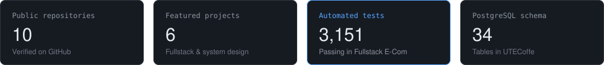
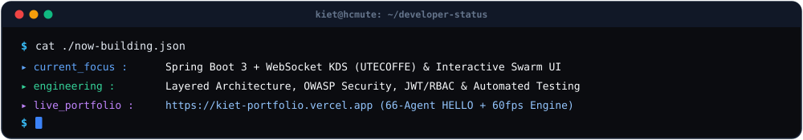
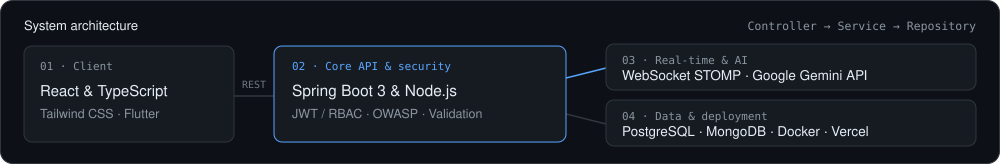

<div align="center">

<!-- Animated Self-Hosted Banner -->
<a href="https://kiet-portfolio.vercel.app" target="_blank">
  
</a>

<br />

<!-- Animated Typing Tagline -->
<a href="https://kiet-portfolio.vercel.app" target="_blank">
  
</a>

<br />

<!-- Primary Action Dock -->
<a href="https://kiet-portfolio.vercel.app" target="_blank">
  
</a>
<a href="mailto:truonggiakiet110806@gmail.com">
  
</a>


</div>

<br />

<!-- Bento Engineering Metrics Strip -->
<div align="center">
  
</div>

<br />

<!-- Animated Developer Terminal -->
<div align="center">
  <a href="https://kiet-portfolio.vercel.app" target="_blank">
    
  </a>
</div>

<br />


<!-- 2-Column Bento Hero: Focus + Live Developer Config -->
<table>
  <tr>
    <td width="50%" valign="top">

### 👨‍💻 Engineering Focus

- 🎓 **Education:** Computer Science @ **HCMUTE**
- 🏗️ **Architecture:** Layered Design (`Controller → Service → Repository`), REST APIs, **JWT / RBAC** & **OWASP**
- ⚡ **Real-Time & AI:** WebSocket (STOMP) & **Google Gemini API**
- 🧪 **Quality:** **3,151 / 3,151 Automated Tests** (`100% pass`)
- 🗄️ **Data Modeling:** **34-Table PostgreSQL** schema (`UTECoffe`)
- 📍 **Base:** Ho Chi Minh City, Vietnam (`GMT+7`)

</td>
    <td width="50%" valign="top">

### ⚡ `kiet.config.ts`

```ts
export const developer = {
  name: "Trương Gia Kiệt",
  handle: "@JiaysTM17",
  role: "Software & Fullstack Developer",
  university: "HCMUTE — Computer Science",
  focus: [
    "Java 21 & Spring Boot",
    "React, TypeScript & Node.js",
    "PostgreSQL, MongoDB & Docker",
  ],
  portfolio: "https://kiet-portfolio.vercel.app",
  openToInternship: true,
};
```

</td>
  </tr>
</table>


## 🛠️ Tech Stack

<div align="center">
  <a href="https://kiet-portfolio.vercel.app" target="_blank">
    
  </a>
  <br /><br />
  <a href="https://kiet-portfolio.vercel.app" target="_blank">
    
  </a>
</div>

<br />

<!-- Animated System Architecture Blueprint -->
<div align="center">
  
</div>

<br />


## 🚀 Featured Projects

<table>
  <tr>
    <td width="50%" valign="top">
      <h3>☕ UTECOFFE — OMO E-Commerce</h3>
      <p>Full-featured tea &amp; coffee chain e-commerce system with <b>34-table PostgreSQL schema</b>, JWT/RBAC auth, Cloudinary media, and real-time <b>WebSocket Barista KDS</b>.</p>
      <p><code>Java 21</code> <code>Spring Boot</code> <code>PostgreSQL</code> <code>WebSocket</code> <code>Docker</code></p>
      <a href="https://github.com/JiaysTM17/UTECoffe"></a>
    </td>
    <td width="50%" valign="top">
      <h3>👗 NEXORA — Fashion Marketplace</h3>
      <p>Next-gen fashion marketplace featuring <b>OOTD Community</b>, <b>Re-Loved Trade-In</b> workflow, Luxury VAS Care, and comprehensive system design docs.</p>
      <p><code>TypeScript</code> <code>System Design</code> <code>Brand Identity</code></p>
      <a href="https://github.com/JiaysTM17/nexora"></a>
    </td>
  </tr>
  <tr>
    <td width="50%" valign="top">
      <h3>🛒 Fullstack E-Commerce</h3>
      <p>Online retail platform hardened with <b>OWASP</b> security, Escrow Vault payment flow, and verified by <b>3,151 / 3,151 Automated Tests</b> (100% pass).</p>
      <p><code>React</code> <code>Node.js</code> <code>Express</code> <code>MongoDB</code></p>
      <a href="https://github.com/JiaysTM17/Fullstack-Ecommerce"></a>
    </td>
    <td width="50%" valign="top">
      <h3>🤖 Personal Portfolio &amp; Swarm UI</h3>
      <p>Dark Brutalist Bento portfolio featuring a custom 60fps <b>66-Agent "HELLO" Intro</b>, 14–18 dynamic swarm cursors, Touring mode &amp; Cursor Vortex.</p>
      <p><code>HTML5</code> <code>Tailwind CSS</code> <code>Vanilla JS 60fps</code></p>
      <a href="https://kiet-portfolio.vercel.app"></a>
      <a href="https://github.com/JiaysTM17/Personal-portfolio"></a>
    </td>
  </tr>
  <tr>
    <td width="50%" valign="top">
      <h3>🧠 Kiệt AI Assistant API</h3>
      <p>Secure bilingual (EN/VI) AI assistant backend powered by <b>Google Gemini API</b>, synced dynamically with GitHub repository context.</p>
      <p><code>Google Gemini API</code> <code>Node.js</code> <code>Express</code></p>
      <a href="https://github.com/JiaysTM17/portfolio-assistant-api"></a>
    </td>
    <td width="50%" valign="top">
      <h3>🎬 LTW Video System</h3>
      <p>Academic web programming video management and streaming platform built for HCMUTE coursework with clean MVC &amp; JPA persistence.</p>
      <p><code>Spring Boot</code> <code>Spring Data JPA</code> <code>Sitemesh 3</code> <code>PostgreSQL</code></p>
      <a href="https://github.com/JiaysTM17/LTW_BT16.11.2026_JPA_Video"></a>
    </td>
  </tr>
</table>

<details>
  <summary><b>📂 More Projects &amp; Coursework (Click to expand)</b></summary>
  <br />

| Repository | Stack | Focus | Link |
| :--- | :--- | :--- | :--- |
| **CampusMind** | `Dart / Flutter` | Mobile application project | [JiaysTM17/CampusMind](https://github.com/JiaysTM17/CampusMind) |
| **Task Manager** | `HTML5` `CSS3` `JavaScript` | Personal productivity app with LocalStorage | [JiaysTM17/task-manager](https://github.com/JiaysTM17/task-manager) |
| **Sitemesh & Validation** | `Java` `Spring` `Sitemesh` | Form validation & layout decorator patterns | [JiaysTM17/LTW_BT19.11.2026_Sitemesh_Validation](https://github.com/JiaysTM17/LTW_BT19.11.2026_Sitemesh_Validation) |

</details>

<br />


## 📊 GitHub Analytics & Contributions

<div align="center">
  
  
</div>

<div align="center">
  
</div>

<div align="center">
  
</div>

<br />

<!-- Animated Contribution Snake (auto-updated daily via GitHub Actions) -->
<div align="center">
  
</div>

<br />

<div align="center">

<a href="https://kiet-portfolio.vercel.app" target="_blank">
  
</a>

<br /><br />


</div>
